# FoodMonitor Dashboard — Cognitive Friction Audit

> **Role**: Senior Product Designer & Data Storytelling Expert  
> **Scope**: Government Dashboard + Farmer Dashboard (live at `localhost:5173`)  
> **Goal**: Enable a non-technical manager to understand business health in **< 60 seconds**, without needing a manual.

---

## Current State: Screenshots

````carousel

<!-- slide -->

<!-- slide -->

<!-- slide -->

<!-- slide -->

````

---

## 1. Confusion Triggers

These are the specific points where a non-technical user will stop, squint, or ask "what does this mean?"

### 🔴 Critical (blocks comprehension)

| # | Location | Trigger | Why It Hurts |
|---|----------|---------|-------------|
| 1 | **Overview → Source block** | Raw machine text: `n1ImportDependency: fallback, confidence=0.10, rows=8 \| n2SupplyChainHealth: missing...` | A policy officer reads this and thinks the system is broken. This is debug output, not insight. |
| 2 | **Price Intel → Commodity names** | `BAWANG BESAR IMPORT (CHINA)`, `BAWANG KECIL MERAH BIASA IMPORT (INDIA)` — all-caps, un-translated, origin-suffix | A minister doesn't know "bawang besar" = "large onion". No English translation, no grouping by category. |
| 3 | **Supply Risk → AI narrative** | Field references like `(dashboardIndices.newsAttention.score)`, `(cfsr.componentMeta.n5PriceVolatility.confidence)` | The AI-generated text leaks internal variable names. A human summary must never contain dot-notation field paths. |
| 4 | **Header → Component mini-bars** | Five tiny colored bars with no labels, no numbers, no tooltip visible on mobile | These are meaningless visual noise without context. A user cannot derive any insight from a 32px bar. |
| 5 | **Overview → Confidence: 21%, Coverage: 21%** | Low-confidence warning buried as plain text, no visual alarm | A policy officer may make decisions on a 21%-confidence score without realizing the data is dangerously incomplete. |

### 🟡 Moderate (slows down comprehension)

| # | Location | Trigger | Suggested Fix |
|---|----------|---------|---------------|
| 6 | **Overview → "Composite Food Security Risk"** label | Technical composite-index jargon | → "How safe is our food supply?" |
| 7 | **Overview → "Delta: +0.8"** | What is "delta"? Delta of what? Over what period? | → "Change since yesterday: +0.8 (slightly higher risk)" |
| 8 | **Price Intel → "Price (USD)" column** | All dashes (`-`) for local PriceCatcher items — wasted column space | Hide USD column when all values are null, or only show for World Bank rows |
| 9 | **News → "Avg Sentiment: 0.14"** | What does 0.14 sentiment *mean*? Is that good or bad? | → Map to words: "Mostly Neutral" / "Slightly Positive" / "Negative" |
| 10 | **News → "Top Commodity: diesel"** | Diesel is technically a commodity but may confuse a food-policy officer expecting food items | → Label: "Most-mentioned item in food security news" |
| 11 | **AI Analysis tab** | Two empty panels with "No gap analysis returned yet." + "db" source badge | → If no data, show a clear "Analysis pending — data pipeline last ran at [time]" message, not raw "db" |
| 12 | **All tabs → "Data fresh" badge** | Users don't know what threshold defines "fresh" | → "Updated 2 hours ago" is clearer than a green dot labeled "Data fresh" |

### 🟢 Minor (cosmetic friction)

| # | Location | Trigger |
|---|----------|---------|
| 13 | **Price table → 30 rows** | No pagination or virtual scrolling — will grow unwieldy |
| 14 | **News filters → "all" option** | Lowercase "all" looks unfinished — should be "All Severities" etc. |
| 15 | **Overview → CFSR chart X-axis** | Repeated "12 Apr" / "13 Apr" labels — redundant tick marks |

---

## 2. The "So What?" Test

Every chart/metric must answer **"So what should I do?"** — here are rewrites:

| Current Element | Current State | Proposed "So What?" Summary |
|-----------------|--------------|----------------------------|
| **CFSR Score: 28, LOW** | Just a number and a badge | ✅ "Food supply is stable. No immediate policy action required." |
| **Delta: +0.8** | Raw number | ✅ "Risk increased slightly since yesterday (+0.8). Monitor but no action needed." |
| **Confidence: 21%** | Plain percentage | ⚠️ **"Warning: This score is based on only 21% of expected data sources. Treat with caution until more data arrives."** (red alert card) |
| **30-Day CFSR Trend** | Line chart, no annotation | ✅ "Risk has been steady around 25-30 for the past week. Previously spiked to ~70 on Apr 11-12." |
| **Component N1-N5 bars** | Five bars with numbers | ✅ Per-bar sentence: "Import dependency: 10 (low) — Malaysia's import reliance is minimal this period." |
| **Dashboard Indices** | Six gauge cards | ✅ Add a sentence under each: e.g., "News Attention: 72 — Media coverage of food issues is elevated. Check the News tab for headlines." |
| **Fuzzy State tiles** | "Fertilizer: low", "Price Trend: stable" | ✅ Synthesize: "Fertilizer costs are low and prices are stable — conditions are favorable for planting." |
| **Price table** | Raw ALL-CAPS commodity rows | ✅ Group by category, highlight anomalous prices in red, add a "price change vs. last week" column |
| **News alerts ribbon** | Cards with severity badges | ✅ Add a 1-sentence implication preview: "Diesel hike may increase transport costs for tofu/soya producers." |
| **AI Supply Risk narrative** | Long paragraph with field references | ✅ Strip all `(field.name)` references. Add a "Key Takeaway" box at the top: "3 risks identified, 2 moderate, 1 low." |

---

## 3. Signal-to-Noise Ratio — Vanity Metrics

These metrics look busy but don't drive decisions:

| Metric | Location | Verdict | Action |
|--------|----------|---------|--------|
| **Component mini-bars in header** | Gov header, below "CFSR 28 LOW" | 🚫 **Remove** | These bars are too small to read and duplicate the Component Breakdown section. They add visual noise to the header. |
| **Coverage % on every Index card** | Overview → Dashboard Indices | 🟡 **Demote** | Coverage matters for data engineers, not policy officers. Move to a `<details>` expand. |
| **Status badge: "observed" / "derived"** | Overview → Dashboard Indices | 🟡 **Demote** | Technical provenance terminology. Hide behind "Where does this data come from?" disclosure. |
| **Insight Score (news table column)** | News tab → table | 🟡 **Demote** | An arbitrary 0-1 score that means nothing to a human. Either map to "Low/Medium/High Relevance" or move to row detail. |
| **"Source: pricecatcher"** on every row | Price table | 🟡 **Simplify** | Show source icon instead of repeating "pricecatcher" 30× — or show once in the section header. |
| **Prompt Hash** in AI Analysis | AI tab → data context detail | 🚫 **Remove from default view** | Only useful for audit trail / debugging. Keep behind "Developer Info" toggle. |

---

## 4. Label Mapping Table

| Current Label (Code/UI) | Improved Non-Technical Label | Notes |
|--------------------------|----------------------------|-------|
| `COMPOSITE FOOD SECURITY RISK` | **"Is Our Food Supply Safe?"** | Frame as a question the user is actually asking |
| `CFSR 28 LOW` | **"Food Risk: 28/100 — Low Risk ✅"** | Add context for the scale |
| `Delta: +0.8` | **"Change from yesterday: +0.8"** | Name the comparison period |
| `Confidence: 21%` | **"Data completeness: 21% ⚠️"** | "Confidence" sounds like opinion; "completeness" is factual |
| `Coverage: 21%` | **"Sources reporting: 21%"** | Clarifies what's being covered |
| `n1ImportDependency` | **"Import Dependency"** | Already mapped in code, but source block leaks raw key |
| `n2SupplyChainHealth` | **"Supply Chain Health"** | Same |
| `n3FertilizerAvailability` | **"Fertilizer Access"** | "Availability" is technical; "Access" is human |
| `n4GeopoliticalRisk` | **"Global Political Risk"** | Geopolitical → more accessible phrasing |
| `n5PriceVolatility` | **"Price Stability"** | Invert framing: users think in positive terms |
| `retailPriceStress` | **"Are retail prices abnormally high?"** | Already in code as `question` — promote this to primary label |
| `statePriceDispersion` | **"How much do prices vary across states?"** | Same — use the question |
| `inputCostStress` | **"Are farming input costs elevated?"** | Same |
| `globalCommodityStress` | **"Are world food prices elevated?"** | Same |
| `newsAttention` | **"How much food-crisis news coverage?"** | Same |
| `dataQuality` | **"How fresh & complete is our data?"** | Same |
| `Fuzzy State Summary` | **"Current Conditions at a Glance"** | "Fuzzy state" is ML jargon |
| `fertilizer: low` | **"Fertilizer costs: Low ✅"** | Add the measurement dimension |
| `priceTrend: stable` | **"Price direction: Stable →"** | Add emoji cue |
| `newsVolume: elevated` | **"News coverage: Elevated ⚠️"** | Add severity indicator |
| `compound: ...` | **"Overall condition: [value]"** | "Compound" means nothing |
| `Avg Sentiment: 0.14` | **"News tone: Slightly Positive"** | Map numeric to human-readable |
| `Insight Score` | **"Relevance"** | Or remove entirely |
| `sentimentSide` | **"Perspective"** (producer / consumer / policy) | "Side" is ambiguous |
| `BAWANG BESAR IMPORT (CHINA)` | **"Large Onion (Imported, China)"** | Translate + restructure |
| `BAWANG KECIL MERAH BIASA IMPORT (INDIA)` | **"Small Red Onion (Imported, India)"** | Same pattern |
| `Data fresh` | **"Last updated: 2h ago"** | Relative time is universally understood |
| `db` (AI source badge) | **"Generated by AI"** | "db" is meaningless |

---

## 5. Redesign Sitemap

### Government Dashboard — Proposed Layout

```mermaid
graph TD
    A["🛡️ Header Bar (sticky)"] --> A1["FoodMonitor · Government"]
    A --> A2["Risk Score: 28/100 Low ✅"]
    A --> A3["Last updated: 2h ago"]
    A --> A4["Tab Navigation"]

    A4 --> B["Tab 1: Overview"]
    A4 --> C["Tab 2: Price Intel"]
    A4 --> D["Tab 3: Supply Risk"]
    A4 --> E["Tab 4: News"]
    A4 --> F["Tab 5: AI Analysis"]

    B --> B1["🎯 HERO: Risk Score Card<br/>Score + Plain text verdict + Trend chart"]
    B --> B2["⚠️ Data Quality Alert<br/>(only if confidence < 50%)"]
    B --> B3["📊 5 Component Cards<br/>with human-readable 1-line summaries"]
    B --> B4["📈 6 Dashboard Index Cards<br/>using QUESTION as primary label"]
    B --> B5["🌡️ Current Conditions<br/>(renamed Fuzzy State)<br/>single synthesized sentence + 4 tiles"]

    C --> C1["🔍 Search + Category Filter"]
    C --> C2["📋 Price Table<br/>Grouped by category, translated names"]
    C --> C3["📉 Price Trend Explorer<br/>with auto-narrative below chart"]
    C --> C4["🌍 World Bank Prices<br/>(collapsed by default)"]

    D --> D1["📝 Key Takeaway Box<br/>(1-2 sentences, red/amber/green)"]
    D --> D2["📄 AI Narrative<br/>(field refs stripped)"]
    D --> D3["⚡ Conflicts (if any)"]
    D --> D4["🔧 Pipeline Health<br/>(collapsed into Advanced drawer)"]

    E --> E1["🚨 Alert Ribbon<br/>(with 1-line implications)"]
    E --> E2["📊 Summary: Articles · Alerts · Tone · Top Item"]
    E --> E3["🎛️ Filters<br/>(moved to collapsible drawer)"]
    E --> E4["📰 News Table<br/>(simplified: 5 columns, not 9)"]

    F --> F1["📋 CFSR Analysis"]
    F --> F2["💡 Recommendations"]
    F --> F3["🔍 Gap Analysis"]
    F --> F4["🔒 Developer Info (collapsed)"]
```



### Key Changes from Current Layout

| Area | Current | Proposed |
|------|---------|----------|
| **Header** | Mini-bars + raw CFSR badge | Clean score + relative timestamp |
| **Overview hero** | Source block with raw field names | Plain English verdict + data quality warning |
| **Component section** | Numbers only | Number + 1-sentence explanation |
| **Index cards** | Title (technical) + question (small) | Question as primary label, title as subtitle |
| **Fuzzy state** | Raw categorical values | Synthesized sentence + emoji-coded tiles |
| **Price table** | Flat ALL-CAPS list | Grouped, translated, with anomaly highlighting |
| **News table** | 9 columns including Insight Score | 5 columns; Insight Score + Side in row detail |
| **AI Supply Risk** | Field references in narrative | Stripped narrative + Key Takeaway box |
| **Filters** | Always visible 3-select row | Collapsible "Filter" drawer |
| **Pipeline Health** | Always visible table | Collapsed into "Advanced" / "System Health" drawer |

---

## 6. Progressive Disclosure Fixes

The current dashboard already uses `<details>` elements — good. But the hierarchy needs adjustment:

| Level | What to Show | Current State | Fix |
|-------|-------------|---------------|-----|
| **Level 0 (Glance)** | Score + badge + 1 sentence | ✅ Score is large | Add plain-English sentence |
| **Level 0 (Glance)** | Data quality warning | ❌ Hidden in small text | Promote to red/amber alert banner if < 50% |
| **Level 1 (Detail)** | Component breakdown, trend, sub-metrics | ✅ Mostly correct | Add per-component sentence |
| **Level 2 (Source)** | "Where does this data come from?" | ⚠️ Source block shows raw debug text | Clean up to: Source name, freshness, coverage % |
| **News** | Filter controls | ⚠️ Always visible | Move into "Filter" collapsible drawer |
| **AI Analysis** | Structured output, data context, prompt hash | ⚠️ Always shown as collapsible | Rename to "Developer Info", move to bottom |

---

## 7. Priority Implementation Order

If acting on this audit, here's the recommended sequence:

1. **Strip field references from AI narrative** — Highest cognitive damage, easiest fix (string replacement in the AI prompt or post-processing)
2. **Replace source block with clean provenance** — Replace raw `n1ImportDependency: fallback...` with human-readable list
3. **Add data quality warning banner** — When confidence < 50%, show an amber/red alert at the top of Overview
4. **Rename labels** — Apply the Label Mapping Table above to all UI text
5. **Add "So What?" sentences** — One sentence per metric card (can be computed from thresholds)
6. **Translate commodity names** — Create a lookup map for Malay → English commodity names
7. **Simplify news table** — Reduce from 9 to 5 visible columns
8. **Collapse filters into drawer** — Wrap news filter selects in a disclosure
9. **Remove header mini-bars** — They duplicate content and add noise
10. **Group prices by category** — Add category headers to the price table
